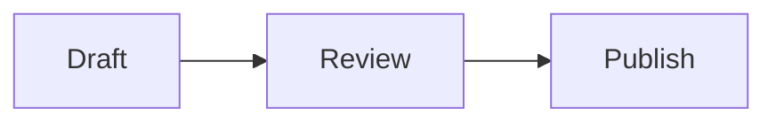

# Mermaid Previewer

Mermaid Previewer is a Chrome extension that renders Mermaid diagrams right on the page. Hover over a preview to copy its Mermaid source or download it as an SVG. The extension renders diagrams locally in Chrome.

On pages covered by a preview rule, use a fenced Markdown code block labeled `mermaid`.

## Preview and export rules

- **URL exclusions** skip matching pages. The Chrome Web Store is excluded by default.
- **Preview rules** find Mermaid source in page elements. The built-in rules cover Mermaid code blocks in Bitbucket Markdown and local `.md` files, as well as standalone `.mmd` and `.mermaid` files. To preview local files, turn on **Allow access to file URLs** on the extension's details page in Chrome, then open the file in Chrome. The rest of a local Markdown document stays in its original text format.
- **SVG export rules** find diagrams rendered by the website. The built-in rules cover GitHub, Gists, and GitLab. Diagrams rendered by the extension already have SVG export controls.

You can add your own rules in Settings. Existing rules and the Sandbox preference carry over from previous releases, including rules saved as URL regular expressions and older URL exclusions and CSS selectors.

## Rendering engine

Pele is the default rendering engine. To switch, choose **Mermaid.js (official)** under **Rendering engine** in Settings, then reload the page you're previewing. The extension also tries Mermaid.js when a diagram uses certain Mermaid.js features or when Pele fails to render it. Sandbox mode always uses Mermaid.js.

## Development

Use Node.js 26.13.1 LTS and pnpm 12.22.0. Run `pnpm install`, then use `pnpm dev` to load the extension in Chrome. `pnpm build` writes an unpacked extension to `dist/chrome`. `pnpm package` writes `dist/mermaid-previewer-chrome.zip`.

Run `pnpm exec playwright install chromium` once and `pnpm test` after building. If a local `.env` points to the old Plasmo build, set `PLAYWRIGHT_EXTENSION_DIR=dist/chrome`.

The manual Chrome Web Store workflow uses the existing `SUBMIT_KEYS` secret and the repository variable `CWS_PUBLISHER_ID` for the Chrome Web Store API v2 publisher ID.

## Changelog

- [1.5.3] Migrated to Extension.js with support for existing settings. Updated Mermaid.js from 11.4.1 to 12.3.0. Made Pele the default renderer and added a setting to switch to Mermaid.js. Added in-page previews for Mermaid code blocks in local `.md` files.
- [1.5.2] Limited content script injection to matching URLs. See [issue #304](https://github.com/zephyraft/mermaid-previewer/issues/304).
- [1.5.1] Removed ZenUML support to fix CSS leaking into web pages.
- [1.5.0] Updated Mermaid.js to 11.4.1 and changed how it is injected. Switched Gist to SVG export once it added native previews. Added support for `zenuml`, `sankey-beta`, `xychart-beta`, `block-beta`, `packet-beta`, `kanban`, and `architecture-beta`.
- [1.4.4] Updated Mermaid.js to 10.5.0. Added experimental Sandbox mode and built-in rules for Gist comments.
- [1.4.3] Fixed a bug.
- [1.4.2] Updated Mermaid.js to 10.2.3 and added support for quadrant charts, C4 diagrams, mind maps, and timelines.
- [1.4.1] Fixed the floating controls and added a button to copy the Mermaid source.
- [1.4.0] Updated Mermaid.js to 10.2.0, migrated to Plasmo, updated the settings page, and added a floating export button.
- [1.3.0] Updated Mermaid.js to 10.1.0 and switched to SVG export for better support for styling and Font Awesome icons.
- [1.2.9] Updated Mermaid.js to 10.0.2 and added support for Font Awesome icons and Git graphs.
- [1.2.8] Updated Mermaid.js to 9.1.3, fixed duplicate notifications, and updated their appearance.
- [1.2.7] Updated Mermaid.js to 8.14.0 and added SVG downloads for diagrams rendered by GitHub.
- [1.2.6] Updated Mermaid.js to 8.13.8 and improved the settings page.
- [1.2.5] Updated Mermaid.js to 8.13.5 and fixed previews on Bitbucket.
- [1.2.4] Added a settings popup for domain exclusions and DOM selectors.
- [1.2.3] Updated Mermaid.js to 8.13.3.
- [1.2.2] Updated Mermaid.js to 8.13.2.
- [1.2.1] Fixed notifications.
- [1.2.0] Added diagram export.
- [1.1.0] Added Bitbucket support and updated Mermaid.js to 8.12.1.
- [1.0.1] Updated Mermaid.js to 8.12.0.
- [1.0.0] Released the first version with Mermaid.js 8.11.5.

## TODO

- [x] Support Font Awesome icons.
- [x] Preview [local Mermaid files](https://github.com/mermaid-js/mermaid-cli).
- [x] Add a floating export button.
- [x] Add a floating button to copy Mermaid source.
- [x] Add automated tests.
- [x] Support Mermaid diagrams in Gist comments.
- [ ] Expand test coverage.

